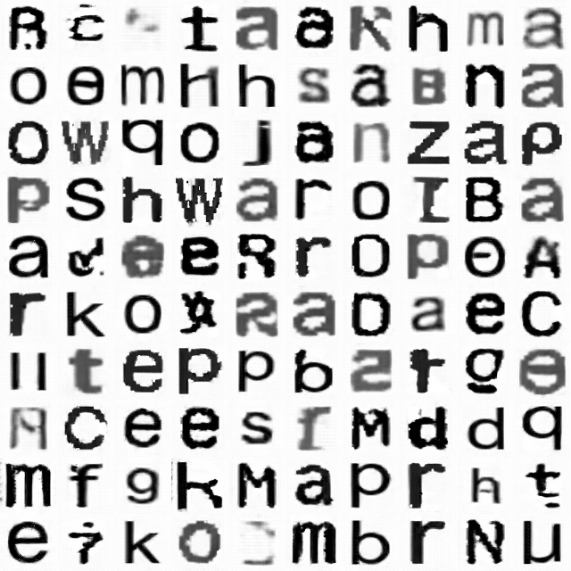
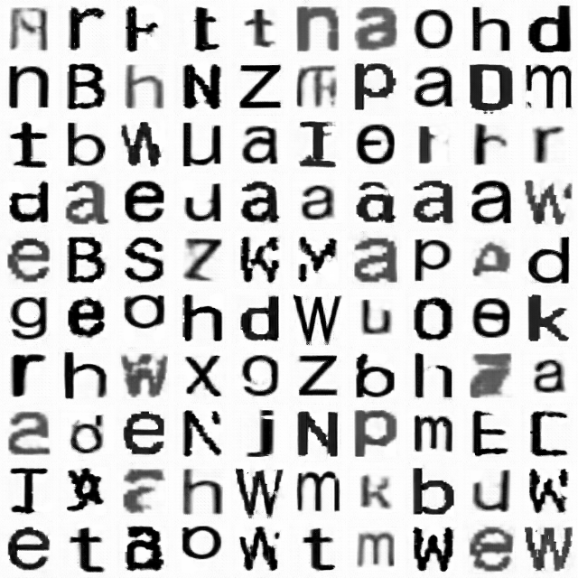
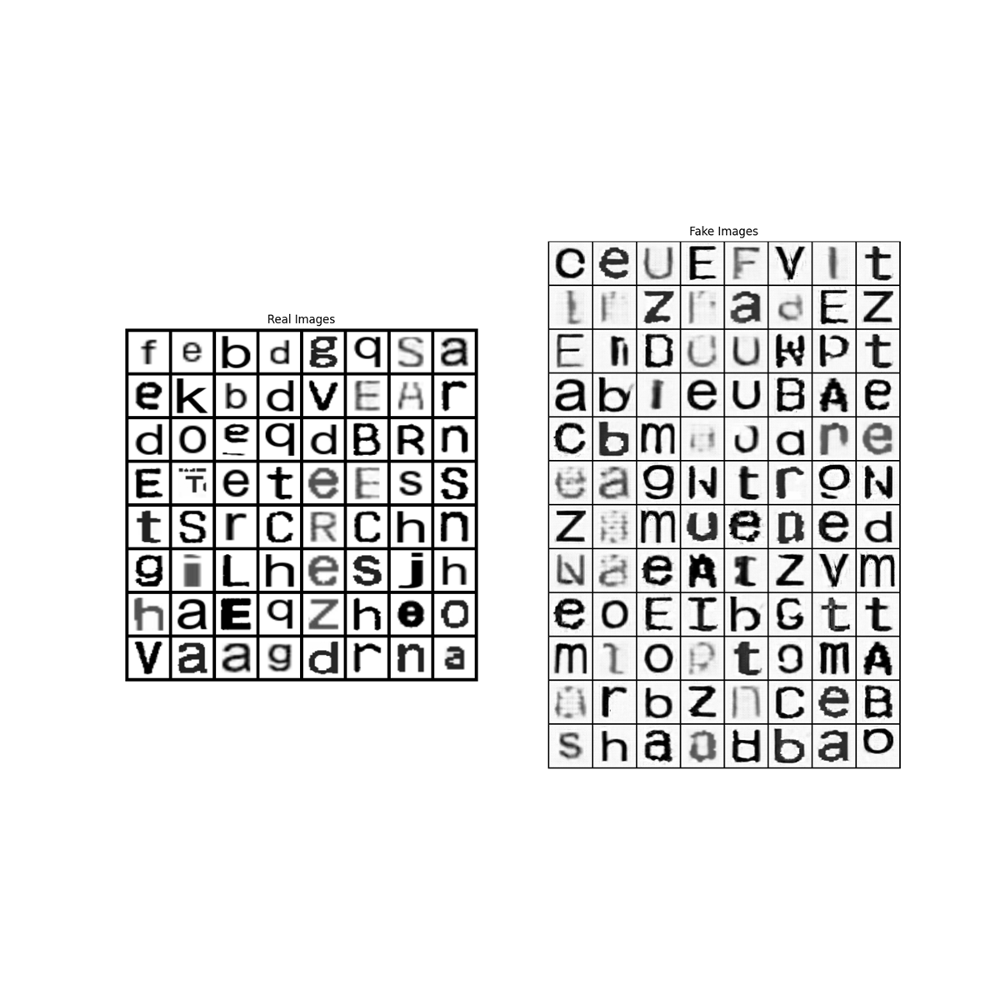
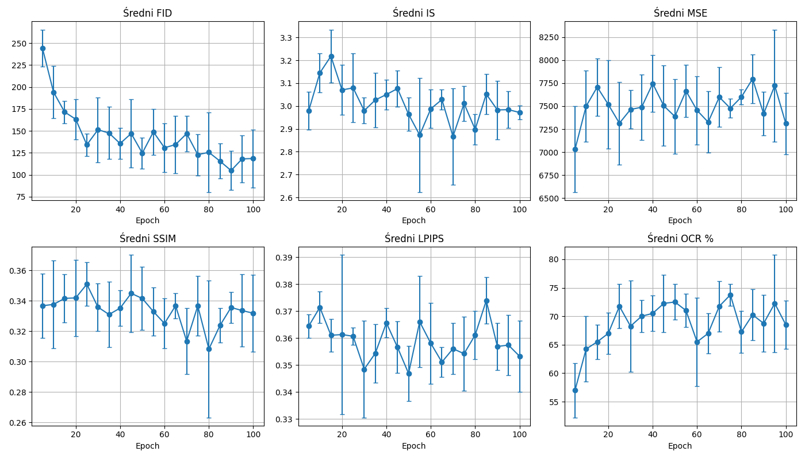

# Scanned Document Tampering Analysis

Research-oriented project developed as part of a master's thesis on analyzing tampering in scanned documents using machine learning.

The project explores a pipeline for generating and analyzing synthetic document modifications at the character level. It combines OCR-based document processing, DCGAN-based character generation, discriminator-based classification and quantitative evaluation of generated samples.

## Project overview

The workflow consists of four main stages:

1. **Document preprocessing**
   - input PDF files are converted to high-resolution images,
   - OCR is used to detect text regions,
   - selected words are replaced with synthetic alternatives,
   - individual character regions are extracted.

2. **Dataset generation**
   - extracted characters are saved as image samples,
   - samples originating from original text are labeled as real,
   - samples originating from modified regions are labeled as fake,
   - metadata is stored in a CSV file.

3. **GAN training**
   - a DCGAN-style generator creates synthetic character images,
   - a discriminator is trained to distinguish real and fake character samples,
   - model checkpoints are saved during training.

4. **Evaluation**
   - generated samples are compared with real character images,
   - evaluation includes:
     - FID,
     - Inception Score,
     - MSE,
     - SSIM,
     - LPIPS,
     - histogram correlation,
     - OCR recognizability,
     - discriminator accuracy.

## Pipeline

```text
PDF documents
     |
     v
PDF -> image conversion
     |
     v
OCR word detection
     |
     v
Synthetic word replacement
     |
     v
Character extraction
     |
     v
Real / fake character dataset
     |
     v
DCGAN training
     |
     v
Generated character samples
     |
     v
Quantitative evaluation
```

## Repository structure

```text
.
├── src/
│   ├── dataset/
│   │   └── prepare_letter_dataset.py
│   ├── gan/
│   │   └── train_gan.py
│   ├── evaluation/
│   │   ├── aggregate_metrics.py
│   │   ├── evaluate_results.py
│   │   └── ocr_generated_letters.py
│   └── visualization/
│       ├── letters_collage.py
│       ├── letters_histogram.py
│       └── pdf_collage.py
│
├── results/
│   ├── figures/
│   └── metrics/
│
├── requirements.txt
├── .gitignore
└── README.md
```

## Dataset preparation

The dataset preparation script processes PDF documents and generates labeled character images.

Expected local structure:

```text
data/
├── pdfs/
├── letters/
└── letters_labels.csv
```

The `data/` directory is intentionally excluded from version control.

To prepare the dataset:

```bash
python src/dataset/prepare_letter_dataset.py
```

The script:

- renders PDF pages at high resolution,
- detects words using Tesseract OCR,
- randomly replaces selected words,
- extracts character regions,
- assigns labels:
  - `0` - original character,
  - `1` - character originating from a modified region,
- stores image filenames and labels in `data/letters_labels.csv`.

## GAN architecture

The project uses a convolutional GAN architecture inspired by DCGAN.

### Generator

The generator takes a random latent vector and progressively upsamples it using transposed convolution layers until a grayscale `64x64` character image is produced.

Main components:

- `ConvTranspose2d`
- `BatchNorm2d`
- `ReLU`
- `Tanh`

### Discriminator

The discriminator receives a grayscale character image and predicts whether it belongs to the real or fake class.

Main components:

- `Conv2d`
- `BatchNorm2d`
- `LeakyReLU`
- `Sigmoid`

The training configuration used in the final experiment includes:

```text
Image size:        64x64
Latent vector:     100
Generator hidden:  64
Discriminator:     64
Batch size:        128
Epochs:            100
Optimizer:         Adam
```

Training can be started with:

```bash
python src/gan/train_gan.py
```

Model checkpoints are created during training but are excluded from this repository because of their size.

## Evaluation

Generated samples can be evaluated using several image-quality and recognition metrics.

The evaluation scripts include:

```text
src/evaluation/evaluate_results.py
src/evaluation/aggregate_metrics.py
src/evaluation/ocr_generated_letters.py
```

Metrics used in the experiments:

| Metric | Purpose |
|---|---|
| FID | similarity between real and generated image distributions |
| Inception Score | quality and diversity of generated images |
| MSE | pixel-level difference |
| SSIM | structural similarity |
| LPIPS | perceptual similarity |
| Histogram correlation | intensity-distribution similarity |
| OCR recognizability | percentage of generated characters recognized by OCR |
| Discriminator accuracy | real/fake classification performance |

Experimental results are stored in:

```text
results/metrics/
```

## Example results

### Real character samples



### Generated character samples



### Real vs generated characters



### Evaluation metrics



Additional visualizations and document-processing examples are available in:

```text
results/figures/
```

## Installation

Create and activate a Python virtual environment, then install the dependencies:

```bash
pip install -r requirements.txt
```

The project also requires external system tools that are not installed through `pip`.

### Tesseract OCR

Tesseract is used for word and character recognition.

The executable must be installed and available in the system path.

### Poppler

Poppler is required by `pdf2image` to render PDF pages.

It must also be installed separately and available in the system path.

## Main dependencies

The project uses:

- Python
- PyTorch
- torchvision
- pandas
- NumPy
- Pillow
- Matplotlib
- Tesseract OCR
- pdf2image
- scikit-image
- LPIPS
- pytorch-fid

## Notes

This repository contains the cleaned research code and representative results from the master's thesis project.

Large datasets, generated character collections and trained model checkpoints are intentionally excluded from the repository.

The project was developed primarily as an experimental research pipeline rather than as a production-ready software package.
